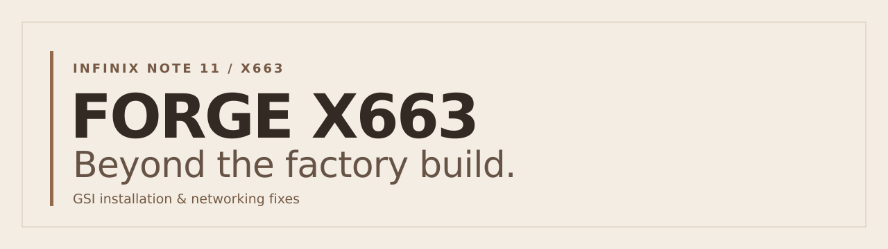
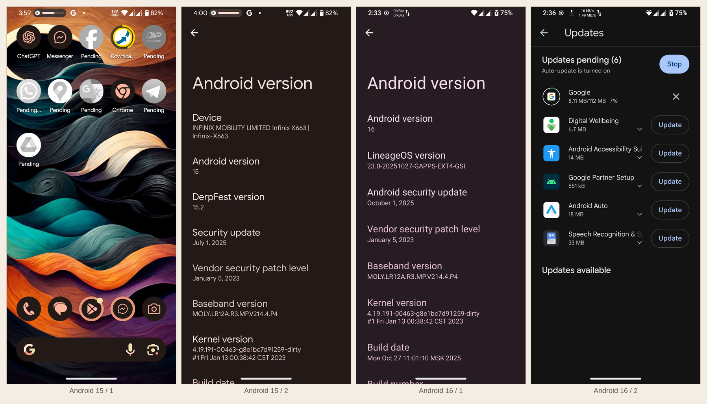

  
# Forge X663
  
> ### What the phone manufacturer didn't want

    

Install an alternative Android system, called a **Generic System Image (GSI)**, on your **Infinix Note 11 (X663)**. Prepare the matching boot patch to address Wi-Fi and mobile-data problems.

A GSI replaces Android’s system image. Stock firmware is the manufacturer’s original software package; match its full build number before choosing a patch file.

**[Read the 22-step installation guide](docs/INSTALLATION.md)** · [Download and verify the images](forge-ready/README.md) · [Troubleshoot a problem](docs/TROUBLESHOOTING.md)

## X663 GSI screenshots

See the Android 15 and Android 16 setup examples below. Open the [original device screenshots](src/) for a closer look, and test networking on your own firmware and GSI combination.

<picture>
  <source media="(max-width: 767px)" srcset="https://raw.githubusercontent.com/MedoX71T/Infinix-X663-GSI-Fixes/main/.github/x663-proof-mobile.png">
  
</picture>

> [!WARNING]
> Unlocking the bootloader and factory reset erase your data. Match your full original stock-firmware build before using a pre-patched image. Keep matching stock recovery files; the included stock boot image is not a complete recovery kit.

## Choose your next step

Follow the full installation guide in order. Android Debug Bridge (ADB) is the computer program used to send commands to a running phone. Use its setup guide or the boot-patch guide when those preparation steps are unfamiliar; both return you to the same installation workflow.

| Your task | Read this | Checkpoint |
| --- | --- | --- |
| Install a GSI for the first time | [The 22-step installation guide](docs/INSTALLATION.md) | Firmware matched, files prepared, GSI installed and tested |
| Set up ADB for the first time | [ADB and fastboot setup](docs/ADB-SETUP.md) | Your computer sees the authorized phone |
| Prepare the networking boot patch | [Boot-patch preparation](docs/BOOT-PATCH.md) | A matching complete boot image is ready |
| Fix networking on an existing GSI | [Apply only the boot patch](docs/BOOT-PATCH.md#apply-the-patch-to-an-existing-gsi) | No unnecessary system erase or GSI reinstall |
| Remove the unlock warning | [Optional LK steps 17–22](docs/INSTALLATION.md#remove-boot-warnings-only-if-you-choose-to) | A separate optional bootloader change |
| Resolve a failed step | [Troubleshooting and recovery](docs/TROUBLESHOOTING.md) | The first error and recovery path identified |

## Match your stock firmware before downloading

Match your full original stock build with this value before using the supplied images:

`X663-H6915ABCEFGHIO-S-GL-230113V402`

Stock firmware is the manufacturer’s original Android software package. Find its complete build in **Settings → My Phone / About phone → Build number** before replacing Android. Compare the whole string, not only the device name, `V402`, or Android version.

- **Exact match**: use the supplied files only with the matching device and documented workflow
- **Different or unknown build**: do not flash these pre-patched images; identify the stock firmware and use your own supported images
- **GSI already installed**: its Android build number does not identify the original stock firmware

Find your matching stock package on [FirmwareFile’s Infinix Note 11 X663 page](https://firmwarefile.com/infinix-note-11-x663/). Check its build and source before using it; FirmwareFile is not Infinix’s official support service.

## Understand the two patches

An image is a software file for one storage area of the phone, not a photograph. The networking patch and warning-removal patch modify different images:

| Task | Image | What it changes |
| --- | --- | --- |
| Address Wi-Fi/mobile-data problems on a GSI | `patched_boot_bpf_fix.img` | A boot-image patch for a MediaTek kernel networking regression |
| Unlocked-bootloader warning | `lk-patched.img` | An optional Little Kernel (LK) bootloader patch |
| Keep an original boot reference | `stock_boot.img` | The saved unpatched boot image for the listed stock build |

Berkeley Packet Filter (BPF) is part of Android’s networking stack. The [upstream BPF patcher](https://github.com/R0rt1z2/mtk-bpf-patcher) addresses a MediaTek kernel bug; it does not add arbitrary missing kernel features. LK warning removal does not repair networking, relock the bootloader, or restore verified boot.

## Download the existing images

Keep the original filenames and check the [SHA-256 checksums](forge-ready/SHA256SUMS) after downloading:

| File | Size in bytes |
| --- | ---: |
| [patched_boot_bpf_fix.img](forge-ready/patched_boot_bpf_fix.img?raw=true) | 33,554,432 |
| [lk-patched.img](forge-ready/lk-patched.img?raw=true) | 1,167,792 |
| [stock_boot.img](forge-ready/stock_boot.img?raw=true) | 33,554,432 |

A matching checksum identifies the saved file. It does not prove device compatibility or provide a trusted signature. Matching stock LK, vbmeta, and other recovery images are not bundled.

Read the [download verification instructions](forge-ready/README.md#verify-your-download) for Windows, Linux, or macOS.

## Selected GSI projects

Choose a GSI from these Doze-off projects:

- [DerpFest Treble](https://github.com/Doze-off/Derpfest_treble)
- [Project Infinity-X](https://github.com/Doze-off/ProjectInfinity-X_gsi)
- [AxionOS](https://github.com/Doze-off/axion_aosp)

Read the chosen project’s release notes and device guidance before downloading. A recommendation does not guarantee that every release or image variant works on X663. Follow the [installation guide’s image-selection checks](docs/INSTALLATION.md#6-prepare-platform-tools-and-the-gsi).

## Questions before flashing

### Do I need to create the BPF patch myself?

Not if your full original stock build matches the supplied image’s target. Use the matching pre-patched file and [verify its checksum](forge-ready/README.md#verify-your-download). For another identified build, follow the supported own-image path in [boot-patch preparation](docs/BOOT-PATCH.md).

### Can I patch boot.img directly on my phone?

Yes. Install the Android application package (APK), [mtk-bpf-patcher-release.apk](forge-ready/mtk-bpf-patcher-release.apk?raw=true), on your phone. Tap **Select File** and choose your matching stock `boot.img`; the app patches it automatically. You don’t need Python or a terminal script for this patching step.

Follow the [phone-patching instructions](docs/BOOT-PATCH.md#path-b-prepare-your-own-matching-boot-image) to prepare the input and save the output. Copy the completed boot image to your computer before unlocking, then follow the [boot-flashing step](docs/INSTALLATION.md#11-flash-the-full-networking-boot-patch).

### Do I install ADB on the phone?

No. ADB and fastboot run on your computer. You enable USB debugging on the phone and authorize the computer’s connection. Follow [ADB setup](docs/ADB-SETUP.md) before sending commands.

### Must I reinstall the GSI to fix networking?

Not merely to apply the boot patch when a GSI already boots and the bootloader is already unlocked. The [existing-GSI path](docs/BOOT-PATCH.md#apply-the-patch-to-an-existing-gsi) changes the matching boot image without adding a system erase, unlock, or factory reset.

### Is the LK warning patch required?

No. LK warning removal is optional and does not repair networking. Keep it separate from the boot patch, and read the [optional LK requirements](docs/INSTALLATION.md#remove-boot-warnings-only-if-you-choose-to) before modifying bootloader code.

## Results and limits

Use the [Android 15, Android 16, and LK screenshots](src/) as setup examples. Check your exact firmware and GSI combination; the screenshots do not establish compatibility with every build.

A working network patch does not guarantee every GSI feature, including carrier calling, hotspot, camera, or encryption. Support depends on the exact stock firmware and GSI release. Do not infer support for another phone or stock build.

## Get help or report a problem

Open an [installation or patch problem report](https://github.com/MedoX71T/Infinix-X663-GSI-Fixes/issues/new?template=problem.yml). Include the full original stock build, exact GSI release, files and partitions changed, current phone mode, and the first error message.

Remove passwords, account details, IMEI, device serials, Wi-Fi names, and private information from logs or screenshots before posting.

Get in touch through:

- [Contact me on Telegram](https://t.me/MedoX71T)
- [Doze-off GSI group](https://t.me/dozeoff_treble), the upstream group rather than a dedicated Forge forum

## Credits and license

Thanks to [R0rt1z2](https://github.com/R0rt1z2) for [mtk-bpf-patcher](https://github.com/R0rt1z2/mtk-bpf-patcher) and [lkpatcher](https://github.com/R0rt1z2/lkpatcher), and to Doze-off for the GSI projects linked above.

The repository retains its [MIT license](LICENSE). The APK, linked tools, and original firmware components retain their own licenses and rights. Software is provided as is, without warranty.

Made with love for the X663 community.
